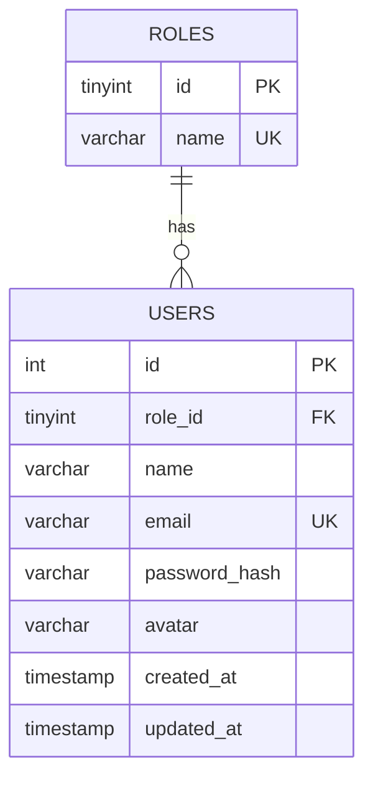

# UserHub — PHP & MySQL User Management System

A responsive, animated **user management system** featuring secure registration, login/logout, administrator CRUD, role-based access, and profile-picture upload.

## Features
- Registration with `password_hash()` and login with `password_verify()`
- Session-based authentication, session-ID regeneration, logout via POST
- Admin-only create/read/update/delete users with confirmation before delete
- Database-backed `admin` and `user` roles
- Search users by name or email
- Profile editing (name, email, optional password, image upload)
- Server-side validation, PDO prepared statements, CSRF tokens, output escaping
- JPG/PNG/WebP validation (actual MIME + image check), 2 MB upload limit
- Responsive dark interface, transitions and reduced-motion support

## Tech stack
PHP 8.1+, MySQL 8+ / MariaDB, HTML5, CSS3, vanilla JavaScript, PDO.

## Setup (XAMPP on Windows)
1. Copy the `user-management-system` folder into `C:\xampp\htdocs\`.
2. Start **Apache** and **MySQL** in XAMPP.
3. Open `http://localhost/phpmyadmin` and import `database/schema.sql` (or paste it in the SQL tab). It creates the `user_management` database and its tables.
4. The defaults in `includes/config.php` are `127.0.0.1`, database `user_management`, username `root`, and blank password. Adjust for your setup or supply environment variables `DB_HOST`, `DB_NAME`, `DB_USER`, `DB_PASS`.
5. Set `APP_BASE` to `/user-management-system` in your web-server environment **or** edit the fallback value in `includes/config.php` from `''` to `'/user-management-system'` (needed for subfolder installs).
6. Open `http://localhost/user-management-system/register.php`, create a user and sign in.
7. To create the **first admin**, run the following SQL in phpMyAdmin **after registering your own account**:
   ```sql
   UPDATE users SET role_id = 1 WHERE email = 'your-email@example.com';
   ```
   Replace the example email with your registered address. Log out and log back in; the **Manage Users** navigation link will appear.

## Database design / ER diagram

**Normalization:** Roles are stored once in `roles` and referenced by `users.role_id`. Each field is atomic (1NF), each table has a single-column primary key (2NF), and role names are not duplicated in the user records (3NF).

## Main routes
| Route | Access | Purpose |
|---|---|---|
| `register.php` | Public | Register |
| `login.php` | Public | Log in |
| `logout.php` | Authenticated POST | Log out |
| `dashboard.php` | Authenticated | Dashboard |
| `profile.php` | Authenticated | Edit own profile/upload image |
| `users.php` | Admin | List/search users |
| `user_form.php` | Admin | Create/edit users |
| `delete_user.php` | Admin POST | Delete users |

## Security notes
Passwords are **one-way hashed**, not reversibly encrypted. Database queries use PDO prepared statements, and HTML output is escaped. Uploaded images are renamed to random filenames and validated server-side. Admin actions require both an authenticated admin session and a valid CSRF token. Self-deletion and self-demotion are prevented.

**Production hardening:** Deploy with HTTPS, set strong DB credentials, configure upload directories to prevent execution at the web-server level (the included `.htaccess` applies to Apache), keep the database credentials out of version control, enable login rate limiting and account recovery, use a trusted SMTP verification flow, and consider moving uploaded images outside the document root. For non-Apache servers configure equivalent upload execution restrictions. No email verification, rate limiting, or password-reset feature is included in this demonstration.

## Test checklist
- [ ] Register a valid user; duplicate email is rejected
- [ ] Wrong password fails; correct password logs in
- [ ] Guest cannot access dashboard; user cannot access admin pages
- [ ] Admin creates a user; edits the user; searches and deletes with confirmation
- [ ] Profile image accepts JPG/PNG/WebP under 2 MB; rejects invalid files
- [ ] Profile updates appear after saving
- [ ] CSRF-less POST requests are rejected
- [ ] Test layouts on mobile and desktop

## Demo video
See `DEMO_SCRIPT.md` for an approximately 8-minute walkthrough.

## GitHub submission
Create a new repository, upload this folder (excluding any real uploaded photos and credentials), and add screenshots/demo video link to this README. The `uploads/.gitignore` file keeps private uploads out of Git.
